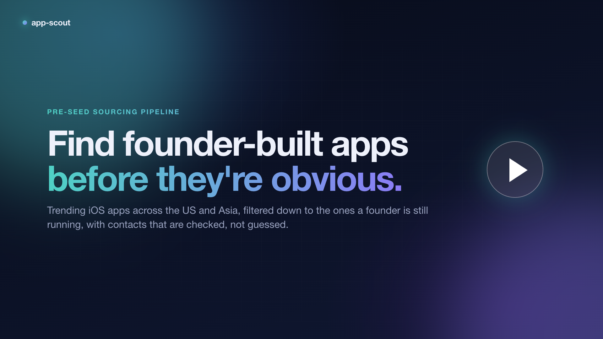

# app-scout

**Find founder-built consumer apps climbing the App Store charts in the US and Asia, and reach the people behind them.**

app-scout pulls the iOS top charts for eight markets, drops anything built by an established company, and
keeps the apps a founder is still running. Then it finds each one's contacts (email, X, LinkedIn, Threads) on the
developer's own pages, and checks every contact before it reaches your list.

[](video/app-scout-demo.mp4)

<p align="center"><sub>▶ Click to watch the walkthrough (1:42, 1080p): how it works, then a full run from install to workbook</sub></p>

---

## Contents

- [What you get](#what-you-get)
- [Quick start](#quick-start)
- [Choosing a timeline](#choosing-a-timeline)
- [Command reference](#command-reference)
- [The workbook](#the-workbook)
- [How it works](#how-it-works)
- [Tuning it to your fund](#tuning-it-to-your-fund)
- [Runtime and rate limits](#runtime-and-rate-limits)
- [Accuracy and limits](#accuracy-and-limits)
- [Responsible use](#responsible-use)
- [Development](#development)

---

## What you get

One run over the 2026-10-24 charts:

| | |
| --- | --- |
| Chart entries collected | 9,397 across 8 markets × 13 categories |
| Unique apps | 4,338 |
| Founder-built apps | **822** |
| Small companies worth a look | 269 |
| Excluded, each with the reason | 3,247 |
| Contacts checked for the top 400 | **329 verified**, 175 likely, 98 rejected |

All of it lands in one Excel workbook, sorted by how hard each app is trending, with every contact coloured by
how far it was verified.

The pipeline was built for a pre-seed fund whose thesis is consumer-heavy (AI-native consumer, social, creator
economy, gaming, entertainment, sports, health, fintech) and leans toward the US and Asia. Every rule maps back to that thesis:

| The fund's thesis | How app-scout applies it |
| --- | --- |
| Idea, MVP or pre-seed | Drops apps first released more than 4 years ago |
| Not too far along for a pre-seed cheque | Drops apps earning $1M+ a month worldwide |
| Founders, not corporates | Drops large publishers and studio portfolios; keeps individual developers and small, young companies |
| Not thin ChatGPT wrappers | Drops generic "Chat GPT" / "AI chatbot" / "AI assistant" apps |
| Consumer categories | Scans games, social, entertainment, photo & video, music, sports, health, lifestyle, finance, productivity, education and business |
| Global ambition, US + Asia | Scans US, Taiwan, Japan, Korea, Singapore, Hong Kong, India and Vietnam, and ranks apps charting in several markets higher |
| Lots of users is good | Downloads never exclude an app. Founder-run apps with big reach are the target |

---

## Quick start

**You need:** macOS or Linux, Python 3.11+, and [uv](https://docs.astral.sh/uv/getting-started/installation/).
Nothing needs an account or API key.

```bash
git clone https://github.com/shaan8/app-scout.git
cd app-scout
```

**1. Collect and filter the charts** (the latest complete day by default):

```bash
uv run python -m scout charts
```

**2. Find and verify contacts** for the top 200 founder apps and top 200 small companies:

```bash
uv run python -m scout contacts
```

**3. Open the workbook:**

```bash
open out/*/app-scout-*.xlsx
```

That's it. uv installs the two dependencies (`openpyxl`, `certifi`) on first run.

---

## Choosing a timeline

By default app-scout looks at a single day. Pass `--days N` to look back over any number of days. This is
the best way to separate apps that are **rising** from apps that spiked once.

```bash
# The last week
uv run python -m scout --days 7 charts
uv run python -m scout --days 7 contacts

# The 30 days up to a specific date
uv run python -m scout --date 2026-10-24 --days 30 charts
uv run python -m scout --date 2026-10-24 --days 30 contacts --limit 300

# One specific day
uv run python -m scout --date 2026-10-24 charts
```

`--date` is the **last** day of the window and `--days` is how many days to go back from it. Use the same
`--date` and `--days` for `charts` and `contacts` so they work on the same run.

**How the score works over a window.** Every chart an app appears on, every day, earns points for its position
plus points for climbing since the previous day. Over a window:

```
trend score = average daily score + ½ × (score on the last day − score on the first day, if positive)
```

So an app that moved from #20 to #2 over the week outranks one that slid from #2 to #20, even though both held
the same positions on average. The workbook adds two columns for windows: **Days charting** (how many days in
the window it was on any chart) and **Rank change** (how many places its best rank improved, first day to last).

| Window | Good for | First run takes |
| --- | --- | --- |
| `--days 1` | A daily snapshot | 10–40 min |
| `--days 7` | Weekly sourcing (recommended) | 1–4 h |
| `--days 30` | Monthly review, spotting slow climbers | overnight |

Most of that time is spent waiting on Sensor Tower's rate limit (see [Runtime and rate limits](#runtime-and-rate-limits)).

Downloaded charts are cached in `.cache/`, so later runs only fetch days they haven't seen. If you run
`--days 7` every Monday, each run only downloads the new days.

Output for a window goes to `out/<date>_<N>d/`; a single day goes to `out/<date>/`.

---

## Command reference

```
uv run python -m scout [global options] <command> [command options]
```

**Global options** (come before the command):

| Option | Default | Meaning |
| --- | --- | --- |
| `--date YYYY-MM-DD` | two days ago | Last chart day to include (the latest complete day) |
| `--days N` | `1` | How many days to look back over, ending at `--date` |
| `--out DIR` | `out` | Where results are written |
| `--cache DIR` | `.cache` | Where downloaded responses are kept |
| `--no-cache` | off | Re-download everything instead of using the cache |

**`charts`**: collect, score and filter apps, then write the workbook.

| Option | Default | Meaning |
| --- | --- | --- |
| `--countries` | `US,TW,JP,KR,SG,HK,IN,VN` | App Store storefronts to scan, comma-separated |

**`contacts`**: find and verify contacts for a finished `charts` run, then rebuild the workbook.

| Option | Default | Meaning |
| --- | --- | --- |
| `--limit N` | `200` | How many top apps per tier to search |
| `--tiers` | `founder,small_company` | Which tiers to search |

Examples:

```bash
uv run python -m scout --days 7 charts --countries US,JP,KR           # just three markets
uv run python -m scout --days 7 contacts --tiers founder --limit 500   # founders only, deeper
```

---

## The workbook

`out/<run>/app-scout-<run>.xlsx`:

| Sheet | What's on it |
| --- | --- |
| **Summary** | The run's dates, counts per tier, contact counts, colour legend and sources |
| **Founders** | Individual developer accounts, plus company accounts with ≤5 apps and ≤3 years on the store. One row per app with its best email, X, LinkedIn and Threads |
| **Small companies** | Passed every exclusion, but an older or larger company account, or a new account already at $500k+/month (a common sign of a big publisher's launch entity) |
| **Contacts** | Every contact found, including rejected ones, with the checks behind each status and the page it came from |
| **Excluded** | Everything else, with the reason it was dropped |

Contact colours: **green** = verified, **yellow** = likely (check before use), **red** = rejected (Contacts
sheet only). All app sheets are sorted by trend score, with filters and frozen headers. App names link to the
App Store and contacts are clickable.

The same data is in machine-readable files next to the workbook:

| File | Contents |
| --- | --- |
| `apps.json` | Every app with its tier, filter reasons and chart facts |
| `contacts.json` | Every contact, the pages it came from and each verification check |
| `rankings.jsonl` | Every raw chart entry collected |
| `run.json` | The dates the run covered |

---

## How it works

```
 Charts                      Filter                     Contacts                   Verify
 ───────────────────         ────────────────────       ────────────────────       ─────────────────────
 Sensor Tower top 25    ──▶  big publishers        ──▶  website, support and  ──▶  email: mail server +
 free/grossing/paid          $1M+/month                 privacy pages the          developer's domain
 × 13 categories             apps > 4 years old         developer lists            X: account exists
 × 8 markets × N days        studio portfolios          + linked about/contact     LinkedIn: page exists
 + Apple top 100             AI chat wrappers           pages                      name matches the app
```

### 1. Collect

| Source | What it gives |
| --- | --- |
| Sensor Tower `api/ios/category_rankings` (public, no login) | Top 25 free, grossing and paid apps per category, country and day, with the previous day's rank and worldwide monthly revenue and download estimates |
| Apple top-chart RSS `rss.marketingtools.apple.com` | Top 100 free and paid apps per country. Today only, so it's used when the window ends within 3 days of today |
| iTunes Lookup API `itunes.apple.com/lookup` | Seller name, release date and the developer's full app portfolio |

### 2. Score

Each chart appearance scores `(26 − rank) / 25` for position, plus `(previous rank − rank) / 25` for climbing
(0.5 for a new entry). Apple's 100-slot feeds score `0.5 × (101 − rank) / 100`. Scores add up across
markets and categories, so an app charting in six countries beats one that tops a single chart. Over several
days, see [Choosing a timeline](#choosing-a-timeline).

### 3. Filter out established companies

An app is excluded if **any** of these hold. The reason is written into the workbook so you can overrule it.

| Check | Threshold |
| --- | --- |
| Publisher or seller is a known large company (~165 names: Google, Meta, ByteDance, Tencent, NetEase, Kakao, Supercell...) | — |
| App name looks like a generic AI chat app | "Chat GPT", "chatbot", "AI assistant", "AIアシスタント"... |
| Worldwide revenue (too far along for pre-seed) | ≥ $1M / month |
| App first released | > 4 years ago |
| Developer portfolio | > 15 apps, or ≥ 6 apps with the first one > 6 years old |

### 4. Spot the founder

Apple labels every seller. An **individual developer account** shows the person's own name. An **organisation
account** shows its legal entity ("Inc.", "Pte. Ltd.", "株式会社", "주식회사", "Anonim Şirketi"...). A seller
name with no legal-entity marker is the strongest solo-founder signal the store gives.

Startups incorporate early, so a **young company** also counts as founder-run: ≤ 5 apps and ≤ 3 years on the
store. Peeps (Kardomo, Inc., 4 apps, first app 2025) is the reference case. A young company already at
$500k+/month goes to *Small companies* instead, because big publishers often launch through fresh one-app entities.

### 5. Find contacts

Neither the App Store nor Sensor Tower publishes emails or social handles. What they do publish is the
developer's **website** (both), a **support URL** (Sensor Tower) and a **privacy policy URL** (Apple requires
one on every app). app-scout reads only those pages, plus up to a few same-site about, contact, team, press and
support pages they link to. If the developer listed a social profile as its website, that profile is recorded
too.

It never guesses addresses (no `firstname@domain` patterns), doesn't use search engines and doesn't log in to anything.

### 6. Verify every contact

| Type | ✅ Verified when | 🟡 Likely when | ❌ Rejected when |
| --- | --- | --- | --- |
| **Email** | The domain is the developer's own website domain **and** it can receive mail (MX record, or A as fallback) | It can receive mail but it's a free mailbox (gmail, naver...) or a domain matching the developer's name | Malformed, the domain can't receive mail, or the domain is unrelated (vendors named in privacy policies) |
| **X** | The account exists (X's public oEmbed endpoint) **and** the handle matches the app, developer or domain | It exists but the handle doesn't match | The account doesn't exist |
| **LinkedIn** | The company page exists **and** matches the name | A personal `/in/` profile or an unclear match: these need a login to check | The company page returns 404 |
| **Threads** | Never: Threads serves the same page for real and missing accounts | Found on an official page | — |

On top of that:

- On a page linking to more than two accounts unrelated to the app, such as a blog's author list, those accounts are rejected.
- Placeholders (`you@example.com`), no-reply addresses and image filenames that look like emails (`logo@2x.png`) are dropped.
- Legal mailboxes (`privacy@`, `dpo@`, `legal@`...) only become the headline email when nothing better exists.

---

## Tuning it to your fund

Everything you'd want to change is in [`scout/config.py`](scout/config.py):

| Setting | What to change |
| --- | --- |
| `COUNTRIES` | Storefront codes to scan by default |
| `CATEGORIES` | App Store genre IDs to scan (`0` is the overall chart) |
| `Thresholds` | Revenue cap, app age, portfolio sizes, what counts as a young company |
| `BIG_PUBLISHERS` | Companies to always exclude. Add any you see slipping through |

For example, a seed fund comfortable with more traction might raise `max_monthly_revenue_usd` to `5_000_000`
and `max_app_age_years` to `6`. For a games-only scan, set `CATEGORIES = {6014: "Games"}`.

---

## Runtime and rate limits

| Step | Cost | Why |
| --- | --- | --- |
| Charts | 10–40 min per new day | 104 Sensor Tower calls per day, at least 4 s apart. Sustained runs get throttled, and throttled calls back off and retry automatically |
| Developer lookups | ~2 min | iTunes allows about 20 requests a minute |
| Contacts | ~15–25 min for 400 apps | One App Store page per second, plus each developer's site |

Every successful response is cached in `.cache/`, so re-running, widening `--limit` or extending `--days` only
fetches what's new. Run long windows in the background:

```bash
nohup uv run python -m scout --days 30 charts > charts.log 2>&1 &
```

---

## Accuracy and limits

- **25 per chart.** Sensor Tower's public endpoint returns the top 25 of each chart. Apple's feed adds the top 100 overall.
- **Estimates.** Revenue and downloads are Sensor Tower's ranges (e.g. `$5k-$50k`), not exact numbers.
- **Shortlist, not verdict.** The seller name can't tell a two-person LLC from a funded startup. Big publishers
  sometimes launch through brand-new one-app companies with low early revenue, and those look like startups in
  this data. Check games from accounts 0.0 years old by hand.
- **Contact coverage.** About a third of founder apps have no usable contact. Their sites are built entirely in
  JavaScript (Notion, some Framer sites), block bots, or list nothing.
- **What "verified" means.** The address can receive mail and belongs to the developer's domain, or the profile
  exists and matches the app. It doesn't mean a particular person reads it.
- **iOS only** for now.

---

## Responsible use

app-scout only collects contact details developers publish on their own pages for people to reach them. Use
them the way they were offered:

- Write personally. Don't add these addresses to bulk mailing lists.
- Honour opt-outs, and follow the rules where you and the founder are (GDPR, CAN-SPAM, PDPA, PIPA, APPI).
- Don't use `privacy@` or `legal@` addresses for outreach.
- Keep `out/` and `.cache/` out of version control. Both are gitignored.

---

## Development

```bash
uv run --with pytest python -m pytest          # 26 tests, all offline
```

```
scout/
  __main__.py    CLI (charts, contacts, --date, --days)
  config.py      markets, categories, thresholds, large-publisher list
  sources.py     Sensor Tower, Apple RSS and iTunes Lookup clients
  http.py        cached, rate-limited, thread-safe fetching
  filter.py      big-company exclusions and the founder signal
  pipeline.py    timeline window, scoring, enrichment, orchestration
  contacts.py    contact discovery from official pages
  verify.py      contact verification
  report.py      the Excel workbook
tests/           filter, scoring and verification tests with a fake network
video/           the demo video: scenes.html is rendered frame by frame
```

To re-render the demo video (needs Google Chrome and ffmpeg):

```bash
uv run --with playwright python video/render.py
```
